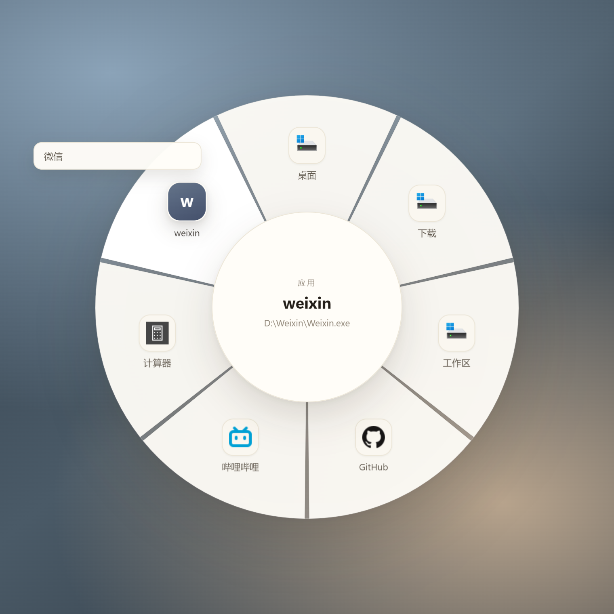
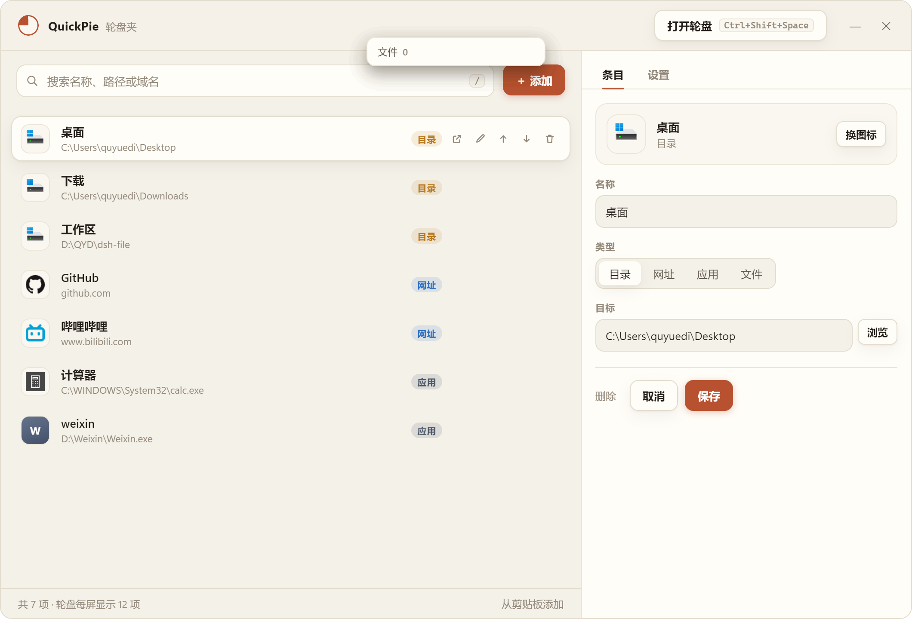
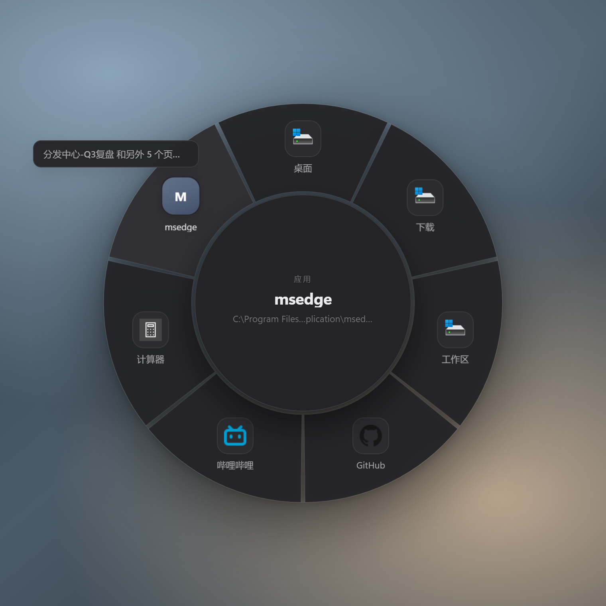

# QuickPie 轮盘夹

把常用的**文件夹、网址、应用**收进一个轮盘，光标处一按即出，点一下就打开。

参考 [PiPie](https://github.com/lifeFxxker/pipie) 的轮盘交互做的，但目标不同：
PiPie 是「已打开窗口的轮盘切换器」，QuickPie 是「常用地址的轮盘收纳夹」——
不关心窗口，只关心你每天要点十次的那几个入口。



## 功能

- **光标处弹出**：`Ctrl+Shift+Space`（可改）在鼠标位置展开轮盘，`Esc` 关掉。
- **三类条目**：文件夹（资源管理器打开）、网址（默认浏览器）、应用/文件（默认程序），
  同一个列表统一管理，自动识别类型。
- **真图标**：Windows 原生取 exe/文件夹/快捷方式图标，网址抓 favicon，失败退字母牌。
- **一点即开**：悬停看名称和完整路径，左键打开；扇区也可点。
- **外环窗口列表**：悬停到「应用」类条目时，在它的扇区外侧拉出这个应用的每个窗口胶囊
  （例如微信的「微信」「图片和视频」），点胶囊直接切到那个窗口。
  窗口枚举由常驻 PowerShell（`Add-Type` 内存编译 C#）完成，不落地新 exe。
- **扇区翻页**：超过 12 项时滚轮翻页，中心显示页码。
- **拖进去就加**：把文件/文件夹/快捷方式/网页链接拖到轮盘或管理器窗口即可。
- **失效标红**：路径不存在的条目在轮盘上灰掉并打红点，管理器里标红。
- **管理器**：搜索、按类型筛选、排序（↑↓）、改名、换类型、换图标、删条目。
- **托盘常驻**：托盘图标一键呼出轮盘 / 打开管理 / 开机自启 / 退出。
- **浅色 / 深色 / 跟随系统**三套外观。

| 管理器 | 深色轮盘 |
| :---: | :---: |
|  |  |

## 运行

直接用打包好的：`dist\QuickPie\QuickPie.exe`，双击即用（无需安装）。

- `dist\QuickPie-0.1.0-win64.zip` 是整个目录的压缩包，解压到任意可写目录即可。
- 程序未签名，首次运行 Windows SmartScreen 会提示「更多信息 → 仍要运行」。
- **便携模式**：`dist\QuickPie\便携模式启动.cmd` 把数据与 Chromium 缓存放到程序目录的
  `PortableData`，适合放 U 盘，也适合在受限 shell（DSH 沙箱、CI）里启动——
  这类环境里 Chromium 自带的沙箱初始化不了，脚本因此多带了 `--no-sandbox`；
  正常双击 `QuickPie.exe` 不受影响，沙箱是开着的。

## 操作速查

| 场景 | 操作 |
| --- | --- |
| 呼出 / 收起轮盘 | `Ctrl+Shift+Space`（全局，托盘菜单里能看到当前键） |
| 打开高亮项 | 左键，或 `Enter` |
| 换高亮 | 鼠标悬停 / `←→↑↓` |
| 翻页 | 滚轮 / `PageUp` `PageDown` |
| 打开管理器 | 轮盘里按 `Tab`，或托盘菜单 |
| 新增 | 管理器 `＋ 添加`、`Ctrl+N`、拖入文件、`从剪贴板添加` |
| 搜索 | 管理器里按 `/` |

## 数据

- 默认：`%APPDATA%\QuickPie\data.json`（示例条目只在首次启动时写入）。
- `QUICKPIE_HOME` 环境变量可指定数据目录；`--user-data-dir` 可直接指定整个 profile。
- 默认目录写不进去时（受限环境 / 只读安装位置），保存会自动退到 exe 同级的 `PortableData`。
- 管理器 → 设置 里能看到实际数据目录，并可导出/导入 JSON。

## 开发

```powershell
# 依赖（electron 已缓存在 D:\QYD\dsh-file\.cache\electron）
npm install

# 截图自检：生成浅色/深色界面截图到 ../../.cache/shots
powershell -ExecutionPolicy Bypass -File scripts\dev-run.ps1 shot
powershell -ExecutionPolicy Bypass -File scripts\dev-run.ps1 shot -Dark

# 数据层自检：类型推断/增删改查/排序/失效检测/落盘
powershell -ExecutionPolicy Bypass -File scripts\dev-run.ps1 selftest

# 生成图标
python scripts\make-icon.py
```

打包（本机可行流程，`electron-builder` 的 NSIS 步骤在这台机器上会因 makensis
内存映射失败，所以走 `dir` 目标 + 手工补图标/版本信息 + 压缩）：

```powershell
node <electron-builder>\out\cli\cli.js --win dir --config.win.signAndEditExecutable=false
# 再用 rcedit 打图标与版本信息，然后把 dist\win-unpacked 改名 dist\QuickPie 并压缩
```

## 外环是怎么实现的

`app/winlist.ps1` 是个常驻进程：`EnumWindows` → PID → exe 路径，每 800ms 往 stdout 吐一行
JSON（已排掉 `Progman`/`WorkerTray` 这类外壳窗口）。主进程解析后按 exe 名缓存，悬停应用条目时
把该 exe 的窗口回传给渲染层，渲染层在扇区外侧排胶囊；点胶囊时用
`WScript.Shell.AppActivate(pid)` 切窗口。

> 为什么不用原生模块：这台机器对**新编译的未签名 exe** 有限制（`ShellExecute`/`Shell_NotifyIcon`
> 返回 `ACCESS_DENIED`），但 PowerShell 是系统签名的程序，`Add-Type` 内存编译不落地文件，
> 反而更稳。副作用是要把子进程的 `TEMP` 指到可写目录，否则 `Add-Type` 会失败。

## 已知边界

- **没有鼠标侧键呼出**：需要全局鼠标钩子，Electron 自带 API 做不到，当前只支持键盘热键
  （顺带一提：pipie 默认就是侧键呼出，没有侧键的鼠标基本用不了它）。
- 轮盘一屏 12 项，更多靠翻页，不做 PiPie 那种连续滚动。
- 外环只有窗口标题，**没有 DWM 实时预览**（那需要把别的窗口画面合成进自己的窗口，
  只有原生 `DwmRegisterThumbnail` 能做，Electron 里拿不到）。
- 没有 PiPie 的窗口预览/把窗口拖进轮盘归组——那属于窗口管理，不在这个工具的范围内。
- 图标是抓取时快照，换程序版本后可在编辑器里点「换图标」刷新。

## 目录

```
quickpie/
├─ main.js              # 主进程：数据、窗口、热键、托盘、打开动作
├─ preload.js           # contextBridge API
├─ app/
│  ├─ index.html        # 轮盘 + 管理器两个视图
│  ├─ styles.css        # 纸面设计系统（浅/深）
│  ├─ wheel.js          # 轮盘几何、交互、拖放
│  └─ manager.js        # 条目管理、设置、热键录制
├─ build/icon.ico       # 应用与托盘图标
├─ scripts/
│  ├─ make-icon.py      # 生成图标
│  └─ dev-run.ps1       # 本地验证入口
└─ dist/
   ├─ QuickPie/         # 解压即用的程序目录
   └─ QuickPie-0.1.0-win64.zip
```

MIT
